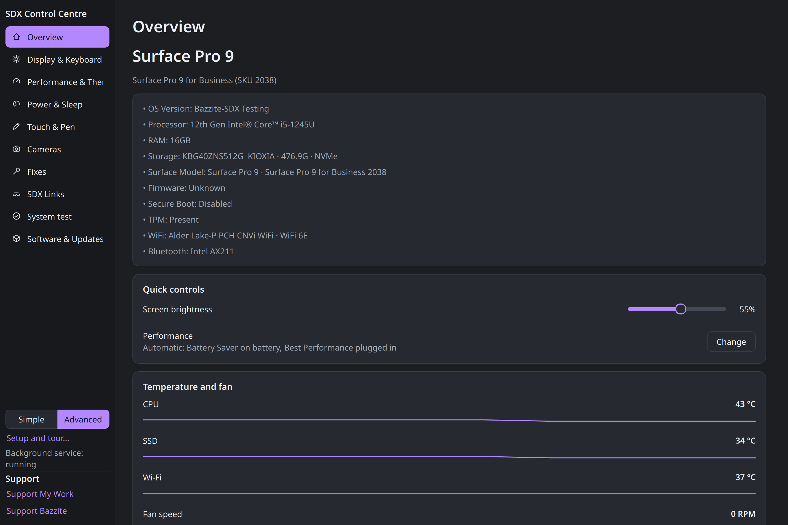

# SDX Control Centre

> SDX Control Centre is a system management application for Bazzite-DX Surface Development Edition. This fork of the original Surface Companion project is integrated into the Bazzite-SDX image build process as a supporting package.

**Built on the shoulders of giants.** SDX Control Centre is a fork of Lane "Madmaxx636" [surface-companion](https://github.com/Madmaxx636/surface-companion). We extend our deepest gratitude to Madmaxx636 for creating and maintaining the original Surface Companion project, which has enabled this fork to exist. Thank you for your contribution to the Surface Linux community!



## Project Status

**SDX Control Centre** is a supporting software package for **Bazzite-SDX**. This fork of the original Surface Companion project is built as an RPM package that gets imported into the Bazzite-SDX image build process.

### Relationship to Bazzite-SDX

- **Bazzite-SDX** is the base image: `ghcr.io/nexgen-3d-printing/bazzite-sdx`
- **SDX Control Centre** is a supporting package: `sdx-control-centre` RPM
- The RPM is built, tested, and included in Bazzite-SDX image releases

## What is SDX Control Centre?

SDX Control Centre is an application for managing Microsoft Surface devices on Bazzite-DX. It provides:

- **Display & Keyboard**: Screen brightness, keyboard backlight control
- **Performance & Thermals**: Power profiles, live temperatures, fan speed monitoring
- **Power & Sleep**: Sleep mode, lid action, charge limit, battery health
- **System Diagnostics**: Health checks, hands-on tests, support bundles

## What's New in This Fork

This is a modified version of the original Surface Companion project, specifically tailored for Bazzite-DX:

- **GPLv3 License**: Upgraded from MIT to GPLv3 for better alignment with Bazzite ecosystem
- **Australian Spelling**: "Centre" instead of "Center" (for our Australian users)
- **rpm-ostree Optimization**: Special handling for Bazzite's image-based updates
- **SDX Links Sidebar**: Quick access to related Bazzite SDX projects
- **Enhanced Overview**: More detailed device information (CPU, RAM, kernel)
- **App Renamed**: Surface Companion → SDX Control Centre

## Installation

### In Bazzite-SDX Images

SDX Control Centre is included as an RPM package in Bazzite-SDX images. No manual installation needed.

### Building the RPM

For development or testing:

```bash
# Enter distrobox container
distrobox enter Fedora-45

# Set up build directories
mkdir -p ~/rpmbuild/{BUILD,BUILDROOT,RPMS,SOURCES,SPECS,SRPMS}
echo '%_topdir /home/NexGen3D/rpmbuild' > ~/.rpmmacros

# Clone source to SOURCES
cd /home/NexGen3D
git clone https://github.com/NexGen-3D-Printing/sdx-control-centre.git
cd sdx-control-centre
cp -r SDX-Control-Centre /home/NexGen3D/rpmbuild/SOURCES/

# Create tarball and build
cd /home/NexGen3D/rpmbuild/SOURCES
tar czf sdx-control-centre-1.0.1.tar.gz SDX-Control-Centre
rpmbuild -ba /home/NexGen3D/rpmbuild/SPECS/SDX-Control-Centre.spec
```

The built RPM will be at `~/rpmbuild/RPMS/noarch/sdx-control-centre-*.rpm`

## Dependencies

- Python 3.10+
- PyQt6
- PyGObject
- polkit
- systemd

## Credits

### Original Project

- **Surface Companion** by [Madmaxx636](https://github.com/Madmaxx636/surface-companion)
- Thank you for creating and maintaining this essential tool for Surface Linux users!

### Bazzite-SDX Integration

- Built on the [linux-surface](https://github.com/linux-surface/linux-surface) kernel stack
- Integrated into [Bazzite-SDX](https://github.com/NexGen-3D-Printing/bazzite-sdx) image builds

## License

GPLv3 - See [LICENSE](LICENSE) for details.

This project is a fork of [Surface Companion](https://github.com/Madmaxx636/surface-companion), which is MIT licensed. Significant modifications have been made for Bazzite-DX compatibility, resulting in the GPLv3 license.

## Contributing

Contributions are welcome! Please feel free to submit a Pull Request.

1. Fork the repository
2. Create your feature branch (`git checkout -b feature/AmazingFeature`)
3. Commit your changes (`git commit -s -m 'Add some AmazingFeature'`)
4. Push to the branch (`git push origin feature/AmazingFeature`)
5. Open a Pull Request

---

## Support & Connect

### Donate to the Original Project

If you appreciate the work that went into Surface Companion, please consider supporting its original creator:

- **Madmaxx636**: [surface-companion on GitHub](https://github.com/Madmaxx636/surface-companion)

### Donate to Bazzite-SDX & This Project

If you find SDX Control Centre useful, you can support the ongoing development:

- **NexGen-3D-Printing**: [ko-fi.com/nexgen3d](https://ko-fi.com/nexgen3d)
- **Bazzite**: [ko-fi.com/universalblue](https://ko-fi.com/universalblue)

### Social Media & Projects

| Platform | Link |
|----------|------|
| GitHub | [github.com/NexGen-3D-Printing](https://github.com/NexGen-3D-Printing) |
| YouTube | [youtube.com/@NexGen-3D](https://www.youtube.com/@NexGen-3D) |
| Reddit | [reddit.com/user/NexGen-3D/](https://www.reddit.com/user/NexGen-3D/) |

---

**Built with ❤️ by NexGen-3D-Printing**

*Making Linux work better for everyone, one device at a time.*

A huge thank you to Madmaxx636 for creating the original Surface Companion project!
